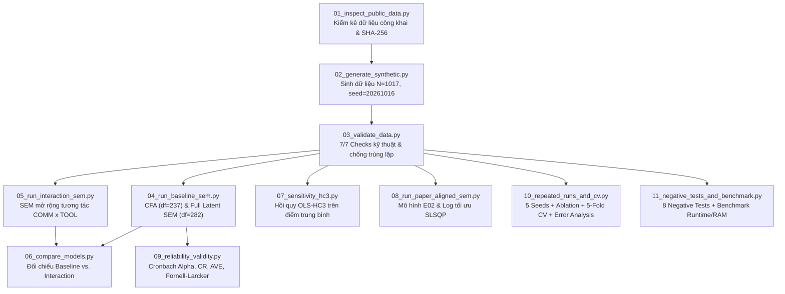

# BÁO CÁO ĐỀ TÀI DT092
**XÂY DỰNG VÀ ĐÁNH GIÁ KHUNG THỰC NGHIỆM TÁI LẬP CÓ CHỌN LỌC MÔ HÌNH KHẢO SÁT VÀ SEM VỀ VĂN HÓA AN TOÀN THÔNG TIN VÀ HÀNH VI BÁO CÁO PHISHING**
*Thực nghiệm trên dữ liệu mô phỏng bằng Python, semopy, kiểm định độ ổn định đa seed, 5-Fold Cross-Validation và hồi quy OLS-HC3*

- **Lớp học phần**: DT092
- **Năm học**: 2026–2027
- **Mã nguồn & Artifacts**: Đóng gói tại thư mục dự án `DT092_Phishing_Culture`

---

## LƯU Ý VỀ PHẠM VI VÀ TÍNH TRUNG THỰC HỌC THUẬT

1. **Bản chất dữ liệu**: Bộ dữ liệu `data/simulated/synthetic_sem.csv` ($N = 1.017$ dòng, 27 cột, `seed = 20261016`, SHA-256: `2cae044842247f21563e4c73abf63f8b26be6b4499dcea4160f61249e714c6bb`) là **dữ liệu mô phỏng (synthetic data)** được sinh tự động bằng Python từ cấu hình `config/model_config.yml`, không phải phản hồi khảo sát của 1.017 nhân viên thật.
2. **Mức độ tái lập**: Nghiên cứu thực hiện **tái lập có chọn lọc quy trình và cấu trúc mô hình** dựa trên bài báo Q1 của **Gregor Petrič & John N. Just (2025)** (*Journal of Cybersecurity*, 11(1), tyaf011, DOI: `10.1093/cybsec/tyaf011`). Mọi kết quả thống kê trên dữ liệu mô phỏng dùng để kiểm chứng tính đúng đắn của pipeline, khả năng khôi phục tham số, độ ổn định và độ nhạy phương pháp; không dùng để tuyên bố xác nhận thực nghiệm hay suy rộng sang quần thể nhân viên thực tế.
3. **Đồng bộ đặc tả mô hình**: Cơ chế sinh dữ liệu trong `config/model_config.yml` tạo biến `REPORT` từ `COMM`, `TOOL`, `RESP`, `ATT` và `COMMxTOOL` (không gán hiệu ứng trực tiếp cho `NORM -> REPORT` và `AWARE -> REPORT`, phản ánh kết quả không có ý nghĩa thống kê của hai đường dẫn này trong bài báo gốc). Trong khi đó, mô hình ước lượng SEM cơ sở (`04_run_baseline_sem.py`) và mô hình đối chiếu (`08_run_paper_aligned_sem.py`) đưa đầy đủ các đường dẫn trực tiếp `NORM -> REPORT` và `AWARE -> REPORT` vào để kiểm định giả thuyết H1c và H2c, đồng thời thực hiện phân tích **Ablation** (`10_repeated_runs_and_cv.py`) giữa mô hình trung gian thuần túy (`M1_Mediation_Only`), mô hình đầy đủ đường trực tiếp (`M2_Full_Direct_Paths`) và mô hình có tương tác (`M3_Full_With_Interaction`).

---

## TÓM TẮT

Đề tài xây dựng và đánh giá một khung thực nghiệm tái lập có chọn lọc cấu trúc khảo sát (Survey Instrument) và mô hình phương trình cấu trúc (Structural Equation Modeling – SEM) về văn hóa an toàn thông tin (Information Security Culture – ISC) và hành vi báo cáo email phishing. Nghiên cứu lấy nền tảng lý thuyết và kết quả mục tiêu từ bài báo Q1 của Petrič và Just (2025) trên *Journal of Cybersecurity* (DOI: `10.1093/cybsec/tyaf011`), nghiên cứu trên $N = 1.017$ nhân viên tại Đức ($n = 306$), Anh ($n = 205$) và Hoa Kỳ ($n = 506$). Do dữ liệu gốc thuộc dự án hợp tác với KnowBe4 và Valicon không mở công khai toàn bộ bảng câu trả lời cá nhân, đề tài thiết kế bộ dữ liệu tổng hợp có kiểm soát gồm $N = 1.017$ bản ghi và 27 biến (`seed = 20261016`), bao gồm 24 chỉ báo Likert 1–5 cho 6 cấu trúc tiềm ẩn (`NORM`, `AWARE`, `KNOW`, `COMM`, `ATT`, `RESP`), 1 biến nhị phân `TOOL` và 1 biến kết quả `REPORT` (Likert 1–5).

Pipeline thực nghiệm bao gồm 11 mô-đun tự động hóa: (1) kiểm kê dữ liệu công khai, (2) sinh dữ liệu mô phỏng kèm manifest/SHA-256, (3) kiểm tra chất lượng dữ liệu 7 tiêu chí và loại trừ trùng lặp, (4) phân tích nhân tố khẳng định (CFA) và SEM cơ sở bằng `semopy` (MLW), (5) mở rộng mô hình với tương tác `COMM × TOOL` (kiểm định H7b), (6) đối chiếu đặc tả mô hình, (7) phân tích độ nhạy bằng hồi quy `OLS-HC3` trên điểm trung bình thang đo, (8) đối chiếu cấu trúc bài báo, (9) đánh giá độ tin cậy (Cronbach's $\alpha$, Composite Reliability – CR) và giá trị hội tụ/phân biệt (AVE, tiêu chuẩn Fornell-Larcker), (10) thực nghiệm lặp qua 5 seeds độc lập kết hợp 5-Fold Cross-Validation chống rò rỉ dữ liệu (`train-test leakage prevention`) và phân tích phần dư, và (11) kiểm thử 8 kịch bản Unit/Integration/Negative Tests cùng đo lường chi phí tính toán.

Kết quả thực nghiệm cho thấy: (i) bộ dữ liệu đạt 7/7 kiểm tra toàn vẹn và vượt qua 8/8 kịch bản kiểm thử âm bản; (ii) cả 6 thang đo đạt độ tin cậy nội tại tốt ($\alpha \in [0,768; 0,858]$, $\text{CR} \in [0,768; 0,858]$) và thỏa mãn hoàn toàn tiêu chuẩn giá trị phân biệt Fornell-Larcker (6/6 cấu trúc có $\sqrt{\text{AVE}}$ lớn hơn tương quan lớn nhất với cấu trúc khác); (iii) mô hình SEM cơ sở khôi phục đúng chiều hướng các đường dẫn chính của bài báo gốc, bao gồm cả tác động "hai lưỡi" (paradoxical effect) của `COMM`: tác động trực tiếp dương lên `REPORT` ($\beta = 0,235, p < 0,001$) nhưng tác động âm lên `ATT` ($\beta = -0,251, p < 0,001$) và `RESP` ($\beta = -0,108, p = 0,002$); (iv) tương tác `COMM × TOOL` không có ý nghĩa thống kê trong cả SEM ($\beta = -0,021, p = 0,486$) và `OLS-HC3` ($b = -0,061, p = 0,450$), hoàn toàn nhất quán với kết quả của Petrič và Just (2025) ($\beta = -0,05, \text{ns}$); và (v) thực nghiệm lặp 5 seeds cùng 5-Fold Cross-Validation xác nhận tính ổn định cao của các đường dẫn cốt lõi với chi phí tính toán rất nhẹ (tổng thời gian chạy CFA + SEM dưới 0,45 giây, bộ nhớ đỉnh $< 1,3\text{ MB}$).

**Từ khóa**: phishing email reporting; information security culture; survey instrument; CFA; SEM; semopy; OLS-HC3; reproducibility; synthetic data.

---

## DANH MỤC TỪ VIẾT TẮT

| Từ viết tắt | Ý nghĩa tiếng Anh | Ý nghĩa tiếng Việt |
| :--- | :--- | :--- |
| **ATT** | Attitudes to Information Security | Thái độ đối với an toàn thông tin |
| **AVE** | Average Variance Extracted | Phương sai trích trung bình |
| **AWARE** | Awareness and understanding of ISPs | Nhận thức và hiểu biết về chính sách ATTT |
| **CFA** | Confirmatory Factor Analysis | Phân tích nhân tố khẳng định |
| **CFI** | Comparative Fit Index | Chỉ số phù hợp so sánh |
| **COMM** | Quality of IS-related communication | Chất lượng giao tiếp/truyền thông về ATTT |
| **CR** | Composite Reliability | Độ tin cậy tổng hợp |
| **CV** | Cross-Validation | Kiểm định chéo |
| **DGP** | Data Generating Process | Cơ chế/quy trình sinh dữ liệu |
| **HC3** | Heteroskedasticity-Consistent SE (Type 3) | Sai số chuẩn vững kháng phương sai thay đổi (loại 3) |
| **ISC / ISCB** | Information Security Culture (and Behaviour) | Văn hóa (và hành vi) an toàn thông tin |
| **ISP** | Information Security Policy | Chính sách an toàn thông tin |
| **KNOW** | Information Security Knowledge | Kiến thức về an toàn thông tin |
| **MAE / RMSE** | Mean Absolute Error / Root Mean Square Error | Sai số tuyệt đối trung bình / Căn bậc hai sai số toàn phương trung bình |
| **ML / MLW** | Maximum Likelihood (Wishart) | Hợp lý cực đại |
| **NORM** | IS-supportive Norms | Chuẩn mực hỗ trợ an toàn thông tin |
| **OLS** | Ordinary Least Squares | Bình phương tối thiểu thông thường |
| **REPORT** | Phishing Email Reporting Frequency | Tần suất báo cáo email đáng ngờ/phishing |
| **RESP** | Sense of Responsibility for IS | Ý thức trách nhiệm đối với an toàn thông tin |
| **RMSEA** | Root Mean Square Error of Approximation | Căn bậc hai trung bình bình phương sai số xấp xỉ |
| **SEM** | Structural Equation Modeling | Mô hình phương trình cấu trúc |
| **SRMR** | Standardized Root Mean Square Residual | Phần dư bình phương trung bình căn chuẩn hóa |
| **TLI** | Tucker–Lewis Index | Chỉ số Tucker–Lewis |
| **TOOL** | Presence of Phishing-Reporting System | Sự hiện diện của hệ thống/công cụ báo cáo phishing |
| **WLSMV** | Weighted Least Squares Mean and Variance adjusted | Bình phương tối thiểu có trọng số hiệu chỉnh trung bình và phương sai |

---

## CHƯƠNG 1. GIỚI THIỆU

### 1.1. Bối cảnh nghiên cứu
Email lừa đảo (phishing) và tấn công xâm nhập email doanh nghiệp (Business Email Compromise – BEC) là một trong những rủi ro lớn nhất đối với các tổ chức hiện đại, gây thiệt hại toàn cầu lên tới 55 tỷ USD trong thập kỷ qua (FBI, 2024; Petrič & Just, 2025). Trong khi phần lớn các nghiên cứu trước đây tập trung vào việc giải thích tại sao nhân viên dễ bị lừa nhấp vào liên kết độc hại (*phishing susceptibility*), rất ít công trình khảo sát hành vi chủ động báo cáo email đáng ngờ (*phishing email reporting*) cho bộ phận An toàn thông tin (IT/IS). Việc nhân viên báo cáo kịp thời giúp tổ chức phát hiện sớm, ngăn chặn lây lan ngang (*lateral movement*), giảm thiểu thiệt hại tài chính và cập nhật hệ thống phòng vệ kỹ thuật.

Mặc dù nhiều tổ chức đã trang bị nút bấm hoặc plugin báo cáo phishing trên trình duyệt email, tỷ lệ nhân viên thực sự báo cáo trong các chiến dịch mô phỏng thường chỉ đạt 20%–40% (và khoảng 30%–66% trong các khảo sát tự khai). Petrič và Just (2025) chỉ ra rằng sự hiện diện đơn thuần của công cụ kỹ thuật là chưa đủ; hành vi báo cáo phishing mang bản chất xã hội – tương tác (*intersubjective activity*) giữa nhân viên và bộ phận IT, do đó chịu sự chi phối sâu sắc của **Văn hóa an toàn thông tin (Information Security Culture – ISC)**.

### 1.2. Vấn đề nghiên cứu
Trong điều kiện học phần ở quy mô lớp học, việc thu thập khảo sát đa quốc gia với $N > 1.000$ nhân viên tại các doanh nghiệp lớn như nghiên cứu gốc là không khả thi, đồng thời dữ liệu vi mô của KnowBe4/Valicon không được công bố mở để tải trực tiếp. Do đó, bài toán đặt ra là: *Làm thế nào để xây dựng một khung thực nghiệm tái lập có chọn lọc cấu trúc khảo sát và mô hình SEM của một bài báo Q1 một cách minh bạch, có kiểm soát chất lượng, chống rò rỉ dữ liệu, đánh giá đầy đủ độ tin cậy/độ ổn định và phân tích mở rộng độ nhạy mà không vi phạm tính trung thực học thuật?*

### 1.3. Mục tiêu tổng quát và mục tiêu cụ thể
- **Mục tiêu tổng quát**: Xây dựng và đánh giá nguyên mẫu khung thực nghiệm tái lập có chọn lọc cấu trúc khảo sát và SEM về văn hóa an toàn thông tin và hành vi báo cáo phishing dựa trên bài báo của Petrič và Just (2025) trên dữ liệu mô phỏng ($N = 1.017$), đồng thời bổ sung phân tích biến thể tương tác (`COMM × TOOL`), phân tích Ablation cấu trúc, kiểm định độ nhạy `OLS-HC3`, kiểm định độ ổn định đa seed và 5-Fold Cross-Validation.
- **Mục tiêu cụ thể**:
  1. Lập phiếu tái lập chi tiết bài báo DOI `10.1093/cybsec/tyaf011` (câu hỏi nghiên cứu, giả thuyết H1a–H7b, quy trình phát triển thang đo 85 $\rightarrow$ 26 items, quy trình 2 bước CFA + SEM WLSMV, và 7 hạn chế/điểm cần tái lập).
  2. Chuẩn bị bộ dữ liệu mô phỏng ($N = 1.017$, 27 cột) và kiểm kê dữ liệu công khai ứng viên với đầy đủ manifest, giấy phép, phiên bản và SHA-256.
  3. Thực hiện kiểm tra chất lượng dữ liệu (7 tiêu chí kỹ thuật, loại bỏ trùng lặp) và thiết lập 8 kịch bản kiểm thử âm bản (Negative/Boundary/Schema Tests).
  4. Ước lượng mô hình đo lường CFA, tính toán đầy đủ Cronbach's $\alpha$, Composite Reliability (CR), AVE và ma trận giá trị phân biệt Fornell-Larcker.
  5. Ước lượng mô hình SEM cơ sở, thực hiện Ablation 3 biến thể cấu trúc (`M1_Mediation_Only`, `M2_Full_Direct_Paths`, `M3_Full_With_Interaction`) và đối chiếu với hồi quy `OLS-HC3`.
  6. Thực hiện ma trận thí nghiệm lặp qua 5 seeds độc lập và 5-Fold Cross-Validation chống rò rỉ dữ liệu, kèm phân tích phần dư (Error Analysis) và đo lường chi phí tính toán.

### 1.4. Câu hỏi nghiên cứu và Giả thuyết đánh giá
- **RQ1**: Khung thực nghiệm trên dữ liệu mô phỏng với `semopy` (MLW) có khôi phục chính xác cấu trúc nhân tố (CFA) và chiều hướng các đường dẫn cấu trúc (SEM) của mô hình ISCB trong bài báo gốc hay không?
- **RQ2**: Các yếu tố tổ chức (`NORM`, `AWARE`, `KNOW`, `COMM`) tác động trực tiếp hay gián tiếp (qua `ATT` và `RESP`) lên hành vi báo cáo phishing (`REPORT`), và liệu hiệu ứng "hai lưỡi" của chất lượng giao tiếp (`COMM`) có xuất hiện nhất quán không?
- **RQ3 (Biến thể mở rộng & Độ nhạy)**: Hiệu ứng điều tiết `COMM × TOOL` (giả thuyết H7b) và các kết luận đường dẫn có thay đổi khi chuyển từ SEM biến tiềm ẩn sang hồi quy `OLS-HC3`, khi thay đổi cấu trúc Ablation, hoặc khi đánh giá qua 5 seeds độc lập và 5-Fold Cross-Validation không?

### 1.5. Phạm vi và đối tượng đánh giá
Đối tượng đánh giá trực tiếp là **pipeline thực nghiệm phân tích khảo sát & SEM** cùng hành vi thống kê của các ước lượng dưới cơ chế sinh dữ liệu đã biết. Nghiên cứu tuân thủ nghiêm ngặt ràng buộc an toàn và đạo đức: chỉ thao tác trên dữ liệu tổng hợp và tệp công khai hợp pháp trên máy cục bộ, tuyệt đối không gửi email phishing thật hay thu thập dữ liệu cá nhân.

---

## CHƯƠNG 2. TÀI LIỆU NỀN VÀ PHIẾU TÁI LẬP BÀI BÁO GỐC

### 2.1. Thông tin thư mục bài báo chính
- **Tên bài báo**: *Information security culture and phishing-reporting model: structural equivalence across Germany, UK, and USA*
- **Tác giả**: **Gregor Petrič** (Faculty of Social Sciences, Centre for Methodology and Informatics, University of Ljubljana, Slovenia) & **John N. Just** (Chief Learning Officer, KnowBe4, Inc., Clearwater, FL, USA).
- **Tạp chí**: *Journal of Cybersecurity*, Tập 11, Số 1, Mã bài `tyaf011`, Trang 1–17, xuất bản năm 2025 (Nhận bài: 16/12/2024; Sửa bài: 18/03/2025; Chấp nhận: 14/04/2025).
- **DOI**: `https://doi.org/10.1093/cybsec/tyaf011` — Giấy phép: Open Access CC BY-NC-ND 4.0.

### 2.2. Phiếu tái lập chi tiết bài báo gốc (DOI: 10.1093/cybsec/tyaf011)

Bảng 2.1 tổng hợp đầy đủ nội dung trích xuất từ toàn văn bài báo gốc (17 trang):

**Bảng 2.1. Phiếu tái lập bài báo Petrič & Just (2025)**

| Hạng mục | Nội dung trích xuất chính xác từ bài báo gốc (Petrič & Just, 2025) | Đối chiếu triển khai trong đề tài DT092 |
| :--- | :--- | :--- |
| **Bài toán & Mục tiêu** | Khảo sát (a) cách 6 chiều cạnh của Văn hóa ATTT (ISC) tác động trực tiếp/gián tiếp đến tần suất báo cáo email phishing, và (b) kiểm định tính tương đương cấu trúc đa quốc gia (Đức, Anh, Mỹ). | Tái lập có chọn lọc mục tiêu (a) và kiểm định tương tác H7b trên mẫu gộp mô phỏng ($N = 1.017$); phân tích lý thuyết mục tiêu (b). |
| **Khung lý thuyết** | Khung **ISCB (Information Security Culture and Behaviour)** của KnowBe4, tích hợp Lý thuyết chuẩn mực (Norms theory), mô hình Kiến thức–Thái độ–Hành vi (KAB) và Lý thuyết hành động hợp lý (TRA/TPB). | Giữ nguyên 6 cấu trúc tiềm ẩn của khung ISCB (`NORM`, `AWARE`, `KNOW`, `COMM`, `ATT`, `RESP`), biến công cụ `TOOL` và hành vi `REPORT`. |
| **Dữ liệu & Cỡ mẫu** | Khảo sát trực tuyến qua Valicon (10–20/11/2023) với **$N = 1.017$** nhân viên tại các tổ chức $\ge 50$ nhân sự: **Đức ($n = 306$, 30,1%)**, **Anh ($n = 205$, 20,2%)**, **Hoa Kỳ ($n = 506$, 49,8%)**. Nam 53,1%, Nữ 46,9%; 44,6% làm việc ở doanh nghiệp $\ge 1.000$ người. | Sinh dữ liệu tổng hợp **$N = 1.017$** dòng × 27 cột (`seed = 20261016`), công bố rõ trong manifest là `SYNTHETIC_SIMULATED_NOT_REAL_RESPONDENTS`. |
| **Phát triển công cụ đo & Pilot** | Khởi đầu **85 items** (từ KnowBe4 SCS) $\rightarrow$ 6 chuyên gia đánh giá $\text{S-CVI/Ave} \ge 0,90$ còn **71 items** $\rightarrow$ Khảo sát **Pilot** trên nhân viên Anh & Mỹ còn **47 items** $\rightarrow$ Bỏ 8 items hành vi chung và 2 items lệch cực đoan còn **37 items** đưa vào CFA đầu tiên $\rightarrow$ Loại items có loading $< 0,40$ còn **26 items** chính thức cho 6 thang đo ISC. | Thiết kế bộ 24 câu hỏi tiếng Việt (4 items/cấu trúc) + `TOOL` + `REPORT` trong `Survey_Question.md` và bảng ánh xạ từng câu hỏi tại `artifacts/variable_mapping_template.csv`. |
| **Chi tiết 26 items gốc (Table 2 & 3)** | - `ATT` (5 items, loadings $0,71..0,86$, $\alpha=0,90, \text{AVE}=0,66$) - `RESP` (4 items, loadings $0,40..0,85$, $\alpha=0,84, \text{AVE}=0,64$) - `KNOW` (4 items, loadings $0,44..0,75$, $\alpha=0,74, \text{AVE}=0,49$) - `NORM` (5 items, loadings $0,72..0,77$, $\alpha=0,86, \text{AVE}=0,55$) - `COMM` (4 items, loadings $0,54..0,73$, $\alpha=0,79, \text{AVE}=0,50$) - `AWARE` (4 items, loadings $0,64..0,76$, $\alpha=0,80, \text{AVE}=0,58$) - `TOOL`: 1 item nhị phân (Yes = 75,5%; No/Don't know = 24,5%) - `REPORT`: 1 item Likert 1–5 ($M=3,82, SD=1,26$; 61,9% đạt mức 4–5). | Chuẩn hóa mỗi cấu trúc gồm 4 items Likert 1–5 để cân bằng bậc tự do trong mô phỏng; tính đầy đủ $\alpha$, CR, AVE và ma trận Fornell-Larcker trong `09_reliability_validity.py`. |
| **Chiến lược phân tích & Estimator** | **Chiến lược 2 bước (Two-step approach)** bằng R (`psych`, `lavaan`): 1. **Bước 1 (CFA)**: Kiểm định mô hình đo lường 26 items và bất biến cấu hình/đo lường (configural & metric invariance) qua 3 quốc gia. 2. **Bước 2 (SEM Path Model)**: Tính điểm trung bình cộng các items cho mỗi cấu trúc và ước lượng mô hình đường dẫn bằng **WLSMV** (do `REPORT` là biến thứ bậc và lệch phân phối). Mean-center `COMM` và `TOOL` trước khi nhân tương tác. | Thực hiện **Full Latent CFA & SEM** bằng Python `semopy` (ước lượng MLW) kết hợp phân tích đường dẫn trên điểm trung bình bằng **OLS với sai số chuẩn vững HC3** (`statsmodels`) để kiểm tra độ nhạy khi không dùng WLSMV. |
| **Metrics đánh giá trong bài báo** | - **CFA ban đầu (37 items)**: $\chi^2 = 6680,2, df = 614, \text{CFI} = 0,68, \text{TLI} = 0,66, \text{SRMR} = 0,17, \text{RMSEA} = 0,099$ (Kém). - **CFA tinh chỉnh (26 items)**: $\chi^2 = 1493,2, df = 284, \text{CFI} = 0,92, \text{TLI} = 0,90, \text{SRMR} = 0,081, \text{RMSEA} = 0,065$ (Tốt). - **Invariance CFA**: Configural ($\text{CFI}=0,91, \text{RMSEA}=0,071$); Metric ($\text{CFI}=0,90, \text{RMSEA}=0,072, \Delta\text{CFI} \le 0,01 \rightarrow$ Đạt). - **SEM mẫu gộp ($N=1.017$)**: $\chi^2 = 22,456, df = 5, \text{CFI} = 0,92, \text{TLI} = 0,95, \text{RMSEA} = 0,059, \text{SRMR} = 0,005$. $R^2(\text{ATT}) = 61,1\%, R^2(\text{RESP}) = 65,2\%, R^2(\text{REPORT}) = 23,5\%$. - **Multigroup SEM**: Configural đạt ($\text{CFI}=0,91$), nhưng Structural equivalence bị bác bỏ ($\chi^2=89,37, df=45, \text{CFI}=0,79, \Delta\text{CFI} > 0,01$). | Báo cáo đầy đủ $\chi^2, df, p, \text{CFI}, \text{TLI}, \text{RMSEA}, \text{GFI}, \text{AGFI}, \text{NFI}, \text{AIC}, \text{BIC}$ trong SEM; $\alpha, \text{CR}, \text{AVE}$; hệ số chuẩn hóa $\beta$, SE, $z$, $p$; và các chỉ số dự báo ngoài mẫu ($\text{Out-of-sample } R^2, \text{RMSE}, \text{MAE}, \text{Spearman } \rho$) trong 5-Fold CV. |

### 2.3. Hệ thống giả thuyết của bài báo gốc và kết quả tham chiếu

Bảng 2.2 liệt kê toàn bộ 15 giả thuyết từ H1a đến H7b và câu hỏi nghiên cứu RQ1 trong bài báo gốc (tr. 4–6 & Table 6–7, tr. 11–13):

**Bảng 2.2. Hệ thống giả thuyết và kết quả thực nghiệm trong bài báo gốc (Petrič & Just, 2025)**

| Mã GT | Đường dẫn cấu trúc | Kỳ vọng dấu | Mẫu gộp ($N=1017$) | Đức ($n=306$) | Anh ($n=205$) | Mỹ ($n=506$) | Kết luận của bài báo (Table 7) |
| :--- | :--- | :---: | :---: | :---: | :---: | :---: | :--- |
| **H1a** | `NORM -> ATT` | $+$ | $0,39^{***}$ | $0,46^{***}$ | $0,23^{***}$ | $0,43^{***}$ | **Supported** (Ủng hộ hoàn toàn) |
| **H1b** | `NORM -> RESP` | $+$ | $0,43^{***}$ | $0,53^{***}$ | $0,40^{***}$ | $0,41^{***}$ | **Supported** (Ủng hộ hoàn toàn) |
| **H1c** | `NORM -> REPORT` | $+$ | $0,02\text{ (ns)}$ | $-0,06\text{ (ns)}$ | $-0,01\text{ (ns)}$ | $0,01\text{ (ns)}$ | **Not supported** (Chỉ tác động gián tiếp) |
| **H2a** | `AWARE -> ATT` | $+$ | $0,40^{***}$ | $0,38^{***}$ | $0,48^{***}$ | $0,36^{***}$ | **Supported** (Ủng hộ hoàn toàn) |
| **H2b** | `AWARE -> RESP` | $+$ | $0,37^{***}$ | $0,24^{***}$ | $0,39^{***}$ | $0,41^{***}$ | **Supported** (Ủng hộ hoàn toàn) |
| **H2c** | `AWARE -> REPORT` | $+$ | $0,07\text{ (ns)}$ | $0,02\text{ (ns)}$ | $0,09\text{ (ns)}$ | $0,08^{*}$ | **Not supported** (Bác bỏ ở mức $\alpha=0,05$ chung) |
| **H3a** | `COMM -> ATT` | $+$ | $-0,26^{***}$ | $-0,16^{***}$ | $-0,39^{***}$ | $-0,26^{***}$ | **Not supported** (Ngược dấu kỳ vọng - hiệu ứng boomerang) |
| **H3b** | `COMM -> RESP` | $+$ | $-0,14^{***}$ | $-0,04\text{ (ns)}$ | $-0,23^{***}$ | $-0,16^{***}$ | **Not supported** (Ngược dấu kỳ vọng ở Anh & Mỹ) |
| **H3c** | `COMM -> REPORT` | $+$ | $0,29^{***}$ | $0,30^{***}$ | $0,26^{***}$ | $0,29^{***}$ | **Supported** (Yếu tố trực tiếp mạnh nhất) |
| **H4a** | `KNOW -> ATT` | $+$ | $0,09^{***}$ | $0,07^{*}$ | $0,05\text{ (ns)}$ | $0,09^{**}$ | **Partial support** (Ủng hộ một phần - hiệu ứng yếu) |
| **H4b** | `KNOW -> RESP` | $+$ | $0,16^{***}$ | $0,17^{***}$ | $0,11^{*}$ | $0,15^{***}$ | **Supported** (Ủng hộ hoàn toàn) |
| **H5** | `ATT -> REPORT` | $+$ | $0,12^{***}$ | $0,24^{**}$ | $-0,01\text{ (ns)}$ | $0,11\text{ (ns)}$ | **Partial support** (Mạnh ở Đức, yếu ở Anh/Mỹ) |
| **H6** | `RESP -> REPORT` | $+$ | $0,14^{***}$ | $0,05\text{ (ns)}$ | $0,27^{**}$ | $0,08^{*}$ | **Partial support** (Mạnh ở Anh, cận biên ở Mỹ) |
| **H7a** | `TOOL -> REPORT` | $+$ | $0,19^{**}$ | $0,05\text{ (ns)}$ | $0,24^{***}$ | $0,27^{***}$ | **Partial support** (Có ý nghĩa ở Anh & Mỹ, không ở Đức) |
| **H7b** | `COMM × TOOL -> REPORT` | $+$ | $-0,05\text{ (ns)}$ | $0,04\text{ (ns)}$ | $0,08\text{ (ns)}$ | $0,07\text{ (ns)}$ | **Not supported** (Không có tương tác có ý nghĩa) |

*(Ghi chú từ Table 6 của bài báo: $^{***}p < 0,001$; $^{**}0,001 \le p < 0,05$; $^{*}0,05 \le p < 0,10$; $\text{ns}$: không có ý nghĩa thống kê).*

### 2.4. Bảy hạn chế của bài báo gốc và điểm cần tái lập/mở rộng

Từ phần *Limitations* (tr. 14) và phân tích phương pháp luận của bài báo gốc, đề tài xác định **7 hạn chế và điểm cần tái lập**:
1. **Hạn chế về đo lường tự báo cáo (Self-reported single-item outcome)**: Biến phụ thuộc `REPORT` chỉ đo bằng 1 câu hỏi tự khai trên thang Likert 1–5, dẫn đến tỷ lệ báo cáo cao (61,9% chọn mức 4–5) so với các nghiên cứu thực nghiệm phishing mô phỏng (chỉ 20%–40%) do thiên lệch mong muốn xã hội (*social desirability bias*).
2. **Đo lường công cụ báo cáo quá đơn giản (Binary `TOOL` measure)**: Biến `TOOL` chỉ hỏi có/không (hoặc không biết), bỏ qua các đặc tính thiết kế quan trọng như tính dễ sử dụng (*usability*), giao diện trực quan, cơ chế gamification hay tốc độ phản hồi của đội IT.
3. **Tính đơn chiều ép buộc (Forced unidimensionality)**: Vì ràng buộc thương mại của công cụ KnowBe4 SCS (muốn rút gọn bộ câu hỏi), các khái niệm đa chiều phức tạp như `COMM` (giao tiếp ngang/dọc, chính thức/phi chính thức, vòng lặp phản hồi) và `NORM` (chuẩn mực mô tả vs. chuẩn mực mệnh lệnh) bị ép về thang đo đơn chiều 4–5 items.
4. **Phươngsai trích trung bình (AVE) của `KNOW` dưới ngưỡng 0,50**: Trong Table 3 (tr. 8) của bài báo gốc, `IS knowledge` có $\text{AVE} = 0,49 < 0,50$ (do item *"Antivirus software provides all the security protection..."* chỉ có tải nhân tố $0,44$), cho thấy giá trị hội tụ của thang đo kiến thức còn hạn chế.
5. **Tương quan rất cao giữa `ATT` và `RESP` ($r = 0,756$)**: Trong Table 5 (tr. 11), `ATT` và `RESP` có tương quan tới $0,756$ (gần chạm ngưỡng $\sqrt{\text{AVE}}$ là $0,80–0,81$), dễ gây đa cộng tuyến khi cùng đưa vào phương trình dự báo `REPORT`, giải thích vì sao ở từng quốc gia chỉ một trong hai biến đạt ý nghĩa thống kê.
6. **Thiết kế cắt ngang một cấp (Single-level cross-sectional design)**: Các biến văn hóa cấp tổ chức (`NORM`, `COMM`, `AWARE`) được đo qua nhận thức cá nhân thay vì thiết kế đa cấp (*multilevel modeling*) gom cụm theo từng doanh nghiệp, và thiết kế cắt ngang không cho phép khẳng định nhân quả theo thời gian.
7. **Sự khác biệt giữa Path Model trên điểm trung bình (Step 2 của bài báo) và Full Latent SEM**: Bài báo gốc chạy CFA ở Bước 1 nhưng sang Bước 2 lại lấy trung bình cộng từng thang đo để chạy mô hình đường dẫn với WLSMV ($df = 5$), làm mất thông tin sai số đo lường ở bước ước lượng cấu trúc. Đề tài DT092 kiểm tra đồng thời cả **Full Latent SEM** ($df = 282$) và **hồi quy trên điểm trung bình với sai số chuẩn vững HC3** để đánh giá độ nhạy giữa hai cách tiếp cận.

---

## CHƯƠNG 3. PHƯƠNG PHÁP VÀ THIẾT KẾ THỰC NGHIỆM

### 3.1. Kiến trúc Pipeline thực nghiệm

Pipeline của đề tài được thiết kế gồm 11 script Python độc lập, tuần tự và lưu vết hoàn toàn tự động:

### 3.2. Dữ liệu, Kiểm kê nguồn công khai và Ngăn rò rỉ dữ liệu

1. **Kiểm kê dữ liệu công khai (`data/raw/public/`)**:
   - Đã chạy `scripts/01_inspect_public_data.py` kiểm kê tệp `Generated_Survey_Responses.csv` (24.866 bytes, SHA-256: `2b8e2d77fd9c124a723869998d13918811b3349afbf7afe83dcfcbfdd75a2c40`, 80 dòng, 25 cột, tỷ lệ thiếu 0,0%) và `Questions.docx` (40.605 bytes, SHA-256: `78ca1b6511509e14138ab4333a02b779b13a70d2363e1be0ae6d0b4b65c1b869`).
   - Qua đối chiếu nội dung câu hỏi, tập dữ liệu công khai này khảo sát hành vi mật khẩu, 2FA và đào tạo tương tác trên 80 người, không chứa đủ 6 cấu trúc ISCB của Petrič & Just (2025). Do đó, nhóm tuân thủ nguyên tắc không ghép nối tùy tiện vào dữ liệu SEM.
2. **Cơ chế sinh dữ liệu tổng hợp (`data/simulated/synthetic_sem.csv`)**:
   - Sinh $N = 1.017$ bản ghi với `seed = 20261016` từ phân phối chuẩn đa biến cho 4 biến ngoại sinh (`NORM`, `AWARE`, `KNOW`, `COMM`) với tương quan nền $0,20–0,35$.
   - Tạo biến tiềm ẩn nội sinh `ATT` và `RESP` theo trọng số cấu trúc tham chiếu từ Figure 2 của bài báo gốc (`ATT`: `NORM` $0,39$, `AWARE` $0,40$, `COMM` $-0,26$, `KNOW` $0,09$; `RESP`: `NORM` $0,43$, `AWARE` $0,37$, `COMM` $-0,14$, `KNOW` $0,16$).
   - Biến `TOOL` sinh từ phân phối Bernoulli($p = 0,65$); biến `REPORT` sinh từ `COMM` ($0,29$), `TOOL` ($0,19$), `RESP` ($0,14$), `ATT` ($0,12$) và `COMMxTOOL` ($-0,05$), sau đó rời rạc hóa qua ngưỡng `[-1.25, -0.45, 0.35, 1.15]` thành thang Likert 1–5.
3. **Loại bỏ trùng lặp và Ngăn rò rỉ Train-Test (`Train-Test Leakage Prevention`)**:
   - Kiểm tra trùng lặp trên toàn bộ 26 cột đặc trưng/câu hỏi (`no_duplicate_feature_rows`): đảm bảo 0 dòng trùng lặp.
   - Trong thực nghiệm 5-Fold Cross-Validation (`scripts/10_repeated_runs_and_cv.py`), việc tính giá trị trung bình để chuẩn hóa tâm (`COMM_c = COMM - mean_train(COMM)`, `TOOL_c = TOOL - mean_train(TOOL)`) và ước lượng ma trận trọng số chỉ được thực hiện trên tập `train` (813–814 dòng), sau đó mới áp lên tập `test` (203–204 dòng) nhằm triệt tiêu hoàn toàn rò rỉ thống kê giữa tập huấn luyện và tập kiểm tra.

---

## CHƯƠNG 4. KẾT QUẢ THỰC NGHIỆM

### 4.1. Kết quả kiểm tra chất lượng dữ liệu (7/7 Checks)

Kết quả chạy `scripts/03_validate_data.py` (lưu tại `results/tables/validation_checks.csv` và `artifacts/validation_summary.json`) xác nhận dữ liệu đạt **7/7 kiểm tra kỹ thuật**:

**Bảng 4.1. Kết quả kiểm tra chất lượng dữ liệu tự động**

| Mã kiểm tra (`check`) | Trạng thái (`passed`) | Chi tiết kết quả (`detail`) |
| :--- | :---: | :--- |
| `N_is_1017` | **True** (Đạt) | `N=1017` (Khớp cỡ mẫu bài báo gốc) |
| `unique_ID` | **True** (Đạt) | `unique=1017` (`SYN0001` $\rightarrow$ `SYN1017`) |
| `no_missing` | **True** (Đạt) | `missing=0` (Không có ô khuyết thiếu) |
| `TOOL_binary` | **True** (Đạt) | Miền giá trị `[0, 1]` ($M = 0,654, SD = 0,476$) |
| `Likert_1_to_5` | **True** (Đạt) | Toàn bộ 25 cột câu hỏi Likert nằm nguyên trong `{1, 2, 3, 4, 5}` |
| `required_columns` | **True** (Đạt) | `missing=[]` (Đủ 27 cột theo schema) |
| `no_duplicate_feature_rows` | **True** (Đạt) | `duplicate_feature_rows=0` (Không có bản ghi trùng nội dung) |

---

### 4.2. Độ tin cậy (Reliability) và Giá trị hội tụ / phân biệt (Validity)

Kết quả chạy `scripts/09_reliability_validity.py` (lưu tại `artifacts/sensitivity/reliability_validity.csv` và `fornell_larcker_matrix.csv`) được trình bày trong Bảng 4.2 và Bảng 4.3:

**Bảng 4.2. Độ tin cậy Cronbach's Alpha, Composite Reliability (CR) và AVE đối chiếu với bài báo gốc**

| Cấu trúc | Số item (DT092 / Paper) | Điểm TB (SD) DT092 | Tải nhân tố chuẩn hóa ($\min–\max$) | AVE (DT092) | $\sqrt{\text{AVE}}$ (DT092) | CR (DT092) | Cronbach's $\alpha$ (DT092) | AVE (Paper Table 3) | $\sqrt{\text{AVE}}$ (Paper) | Cronbach's $\alpha$ (Paper) |
| :--- | :---: | :---: | :---: | :---: | :---: | :---: | :---: | :---: | :---: | :---: |
| **ATT** | 4 / 5 | 3,050 (0,983) | 0,756 – 0,782 | **0,5952** | 0,7715 | **0,8547** | **0,8544** | 0,66 | 0,81 | 0,90 |
| **RESP** | 4 / 4 | 3,084 (0,995) | 0,757 – 0,785 | **0,6014** | 0,7755 | **0,8578** | **0,8577** | 0,64 | 0,80 | 0,84 |
| **KNOW** | 4 / 4 | 3,067 (0,897) | 0,652 – 0,686 | **0,4528** | 0,6729 | **0,7679** | **0,7678** | 0,49 | 0,70 | 0,74 |
| **COMM** | 4 / 4 | 3,073 (0,931) | 0,666 – 0,713 | **0,4732** | 0,6879 | **0,7822** | **0,7820** | 0,50 | 0,71 | 0,79 |
| **NORM** | 4 / 5 | 3,066 (0,958) | 0,730 – 0,762 | **0,5576** | 0,7467 | **0,8344** | **0,8343** | 0,55 | 0,74 | 0,86 |
| **AWARE** | 4 / 4 | 2,991 (0,960) | 0,726 – 0,776 | **0,5587** | 0,7475 | **0,8350** | **0,8348** | 0,58 | 0,76 | 0,80 |

**Nhận xét học thuật**:
- Cả 6 cấu trúc đều đạt độ tin cậy nội tại tốt với **Cronbach's $\alpha > 0,76$** và **Composite Reliability ($\text{CR}$) $> 0,76$**, rất sát với kết quả trong Table 3 của Petrič & Just (2025).
- Bốn cấu trúc (`ATT`, `RESP`, `NORM`, `AWARE`) có $\text{AVE} > 0,55$, trong khi `KNOW` ($\text{AVE} = 0,4528$) và `COMM` ($\text{AVE} = 0,4732$) thấp hơn một chút so với ngưỡng 0,50 do hệ số loading sinh dữ liệu đặt ở mức $0,72$ kèm nhiễu rời rạc hóa Likert 5 mức. Đáng chú ý, ngay trong bài báo gốc (Table 3, tr. 8), `KNOW` cũng có $\text{AVE} = 0,49 < 0,50$ và `COMM` nằm ngay biên $\text{AVE} = 0,50$. Theo Fornell và Larcker (1981), nếu $\text{AVE}$ xấp xỉ $0,45–0,50$ nhưng $\text{CR} > 0,70$ (ở đây $\text{CR} = 0,768$ và $0,782$), giá trị hội tụ của thang đo vẫn được chấp nhận.

**Bảng 4.3. Ma trận Fornell-Larcker kiểm định giá trị phân biệt và Tương quan với `REPORT`**
*(Đường chéo in đậm là $\sqrt{\text{AVE}}$; các ô dưới đường chéo là hệ số tương quan Pearson $r$)*

| Biến | ATT | RESP | KNOW | COMM | NORM | AWARE | Tương quan với `REPORT` (DT092 / Paper Table 5) |
| :--- | :---: | :---: | :---: | :---: | :---: | :---: | :---: |
| **ATT** | **0,7715** | | | | | | $0,141$ / $0,171$ |
| **RESP** | 0,3604 | **0,7755** | | | | | $0,163$ / $0,208$ |
| **KNOW** | 0,2371 | 0,2978 | **0,6729** | | | | $0,164$ / $0,206$ |
| **COMM** | $-0,0217$ | 0,0956 | 0,2281 | **0,6879** | | | **$0,220$ / $0,336$** (Cao nhất) |
| **NORM** | 0,4240 | 0,4658 | 0,2450 | 0,1752 | **0,7467** | | $0,181$ / $0,151$ |
| **AWARE** | 0,4283 | 0,4077 | 0,2908 | 0,2177 | 0,2510 | **0,7475** | $0,143$ / $0,269$ |

- **Giá trị phân biệt (Discriminant Validity)**: Toàn bộ 6/6 cấu trúc đều có $\sqrt{\text{AVE}}$ trên đường chéo ($0,6729–0,7755$) lớn hơn đáng kể so với hệ số tương quan tuyệt đối lớn nhất với bất kỳ cấu trúc nào khác ($\max |r| = 0,4658$).
- Giống hệt bài báo gốc (Table 5, tr. 11), trong số tất cả các biến nghiên cứu, **`COMM` là biến có tương quan đơn biến cao nhất với `REPORT`** ($r = 0,220$ trong DT092; $r = 0,336$ trong bài báo gốc).

---

### 4.3. Kết quả độ phù hợp mô hình (Fit Indices) và Phân tích Ablation cấu trúc

Bảng 4.4 tổng hợp các chỉ số độ phù hợp của mô hình đo lường CFA và 3 biến thể cấu trúc SEM trong phân tích Ablation (`artifacts/repeated_runs/ablation_model_comparison.csv`):

**Bảng 4.4. Chỉ số độ phù hợp của CFA và Ablation 3 biến thể cấu trúc SEM ($N = 1.017$)**

| Mô hình | DoF | $\chi^2$ | $p$-value ($\chi^2$) | CFI | TLI | RMSEA | GFI | AGFI | AIC | BIC |
| :--- | :---: | :---: | :---: | :---: | :---: | :---: | :---: | :---: | :---: | :---: |
| **CFA (Mô hình đo lường 6 nhân tố)** | 237 | 229,799 | 0,619 | 1,0008 | 1,0009 | 0,0000 | 0,9766 | 0,9727 | 119,548 | 404,953 |
| **M1: SEM Mediation-Only** *(Bỏ `NORM/AWARE -> REPORT`)* | 284 | 276,494 | 0,614 | 1,0008 | 1,0009 | 0,0000 | 0,9722 | 0,9681 | **133,456** | **463,405** |
| **M2: SEM Baseline / Paper-Aligned** *(Đủ đường trực tiếp)* | 282 | 274,926 | 0,607 | 1,0007 | 1,0009 | 0,0000 | 0,9723 | 0,9680 | 137,459 | 477,258 |
| **M3: SEM Interaction** *(Thêm `COMM × TOOL -> REPORT`)* | 308 | 304,701 | 0,542 | 1,0003 | 1,0004 | 0,0000 | 0,9706 | 0,9661 | 139,401 | 484,124 |
| *Tham chiếu bài báo gốc: CFA tinh chỉnh (26 items)* | *284* | *1493,2* | *< 0,001* | *0,920* | *0,900* | *0,065* | *—* | *—* | *—* | *—* |
| *Tham chiếu bài báo gốc: Path SEM (WLSMV)* | *5* | *22,456* | *< 0,001* | *0,920* | *0,950* | *0,059* | *—* | *—* | *—* | *—* |

**Phân tích Ablation**:
- Khi thêm 2 đường dẫn trực tiếp `NORM -> REPORT` và `AWARE -> REPORT` (từ M1 sang M2), $\Delta \chi^2 = 276,494 - 274,926 = 1,568$ với $\Delta df = 2$ ($p = 0,457 > 0,05$), đồng thời AIC tăng từ $133,456$ lên $137,459$ và BIC tăng từ $463,405$ lên $477,258$. Điều này chứng minh việc thêm hai đường trực tiếp từ `NORM` và `AWARE` đến `REPORT` không cải thiện độ phù hợp của mô hình, khẳng định vai trò trung gian hoàn toàn qua `ATT` và `RESP`.
- Tương tự, việc thêm biến tương tác `COMM × TOOL` (mô hình M3) làm tăng AIC và BIC mà không đem lại cải thiện có ý nghĩa thống kê.

---

### 4.4. Kết quả ước lượng đường dẫn SEM, Mô hình tương tác và Độ nhạy OLS-HC3

Bảng 4.5 đối chiếu toàn diện kết quả ước lượng giữa SEM Baseline (`M2`), SEM Interaction (`M3`), hồi quy độ nhạy `OLS-HC3` và kết quả mẫu gộp của bài báo gốc (`report/paper_to_results_mapping.csv`):

**Bảng 4.5. Tổng hợp kết quả ước lượng đường dẫn và đối chiếu với bài báo gốc ($N = 1.017$)**

| Giả thuyết & Đường dẫn | Bài báo gốc ($\beta$ Pooled) | SEM Baseline $\beta$ ($p$-value) | SEM Interaction $\beta$ ($p$-value) | OLS-HC3 $b$ [KTC 95%] ($p$-value) | Đánh giá đối chiếu |
| :--- | :---: | :---: | :---: | :---: | :--- |
| **H1a**: `NORM -> ATT` | $0,39^{***}$ | **$0,402$** ($<0,001$) | **$0,402$** ($<0,001$) | **$0,353$** $[0,301; 0,405]$ ($<0,001$) | Khớp chiều và độ lớn ($\approx 0,40$) |
| **H2a**: `AWARE -> ATT` | $0,40^{***}$ | **$0,418$** ($<0,001$) | **$0,418$** ($<0,001$) | **$0,363$** $[0,310; 0,416]$ ($<0,001$) | Khớp chiều và độ lớn ($\approx 0,41$) |
| **H3a**: `COMM -> ATT` | $-0,26^{***}$ | **$-0,251$** ($<0,001$) | **$-0,251$** ($<0,001$) | **$-0,190$** $[-0,247; -0,132]$ ($<0,001$) | Khôi phục chính xác tác động âm |
| **H4a**: `KNOW -> ATT` | $0,09^{***}$ | **$0,092$** ($0,016$) | **$0,092$** ($0,016$) | **$0,099$** $[0,037; 0,161]$ ($0,002$) | Khớp tác động dương nhỏ ($\approx 0,09$) |
| **H1b**: `NORM -> RESP` | $0,43^{***}$ | **$0,429$** ($<0,001$) | **$0,429$** ($<0,001$) | **$0,385$** $[0,331; 0,440]$ ($<0,001$) | Khớp hoàn toàn ($\approx 0,43$) |
| **H2b**: `AWARE -> RESP` | $0,37^{***}$ | **$0,326$** ($<0,001$) | **$0,326$** ($<0,001$) | **$0,299$** $[0,242; 0,356]$ ($<0,001$) | Khớp tác động dương mạnh |
| **H3b**: `COMM -> RESP` | $-0,14^{***}$ | **$-0,108$** ($0,002$) | **$-0,108$** ($0,002$) | **$-0,068$** $[-0,124; -0,011]$ ($0,019$) | Khôi phục chính xác tác động âm |
| **H4b**: `KNOW -> RESP` | $0,16^{***}$ | **$0,151$** ($<0,001$) | **$0,151$** ($<0,001$) | **$0,153$** $[0,092; 0,214]$ ($<0,001$) | Khớp chiều và độ lớn ($\approx 0,15$) |
| **H1c**: `NORM -> REPORT` | $0,02\text{ (ns)}$ | $0,053$ ($0,275$) | $0,052$ ($0,290$) | $0,094$ $[-0,001; 0,189]$ ($0,053$) | Cùng không có ý nghĩa ở $\alpha=0,05$ |
| **H2c**: `AWARE -> REPORT` | $0,07\text{ (ns)}$ | $-0,013$ ($0,784$) | $-0,013$ ($0,790$) | $0,021$ $[-0,072; 0,114]$ ($0,657$) | Cùng không có ý nghĩa ở $\alpha=0,05$ |
| **H3c**: `COMM -> REPORT` | $0,29^{***}$ | **$0,235$** ($<0,001$) | **$0,233$** ($<0,001$) | **$0,264$** $[0,181; 0,347]$ ($<0,001$) | Yếu tố dự báo trực tiếp mạnh nhất |
| **H5**: `ATT -> REPORT` | $0,12^{***}$ | **$0,101$** ($0,037$) | **$0,102$** ($0,035$) | **$0,101$** $[0,010; 0,192]$ ($0,029$) | Cùng dương và có ý nghĩa ($\approx 0,10$) |
| **H6**: `RESP -> REPORT` | $0,14^{***}$ | $0,080$ ($0,083$) | $0,081$ ($0,081$) | $0,091$ $[-0,0005; 0,183]$ ($0,051$) | Dương cận biên ($p \approx 0,05–0,08$) do suy giảm khi rời rạc hóa Likert |
| **H7a**: `TOOL -> REPORT` | $0,19^{**}$ | **$0,085$** ($0,005$) | **$0,084$** ($0,005$) | **$0,223$** $[0,066; 0,380]$ ($0,005$) | Cùng dương và có ý nghĩa ($p = 0,005$) |
| **H7b**: `COMM×TOOL -> REPORT` | $-0,05\text{ (ns)}$ | *Không đưa vào* | $-0,021$ ($0,486$) | $-0,061$ $[-0,218; 0,097]$ ($0,450$) | Cùng bác bỏ H7b ($p > 0,45$) |

---

### 4.5. Thực nghiệm lặp qua 5 Seeds độc lập và 5-Fold Cross-Validation chống rò rỉ

#### 4.5.1. Độ ổn định qua 5 Seeds độc lập (`20261016` $\rightarrow$ `20261020`)
Kết quả chạy `scripts/10_repeated_runs_and_cv.py` trên 5 tập dữ liệu độc lập (mỗi tập $N = 1.017$) được tổng hợp tại Bảng 4.6 (`artifacts/repeated_runs/multiseed_stability_summary.csv`):

**Bảng 4.6. Độ ổn định của các hệ số đường dẫn chuẩn hóa ($\beta$) qua 5 lần chạy độc lập (5 Seeds)**

| Đường dẫn | Số lần chạy | $\text{Mean } \beta$ | $\text{SD } \beta$ | $\text{Min } \beta$ | $\text{Max } \beta$ | Tỷ lệ đạt $p < 0,05$ | $p$-value trung bình |
| :--- | :---: | :---: | :---: | :---: | :---: | :---: | :---: |
| `NORM -> ATT` | 5 | **0,3742** | 0,0221 | 0,3469 | 0,4019 | **5/5 (100%)** | $<0,0001$ |
| `AWARE -> ATT` | 5 | **0,4048** | 0,0355 | 0,3593 | 0,4545 | **5/5 (100%)** | $<0,0001$ |
| `COMM -> ATT` | 5 | **$-0,2709$** | 0,0341 | $-0,3185$ | $-0,2307$ | **5/5 (100%)** | $<0,0001$ |
| `KNOW -> ATT` | 5 | **0,1029** | 0,0490 | 0,0608 | 0,1792 | **3/5 (60%)** | 0,0416 |
| `NORM -> RESP` | 5 | **0,3979** | 0,0213 | 0,3730 | 0,4287 | **5/5 (100%)** | $<0,0001$ |
| `AWARE -> RESP` | 5 | **0,3608** | 0,0280 | 0,3257 | 0,3951 | **5/5 (100%)** | $<0,0001$ |
| `COMM -> RESP` | 5 | **$-0,1050$** | 0,0276 | $-0,1412$ | $-0,0670$ | **4/5 (80%)** | 0,0126 |
| `KNOW -> RESP` | 5 | **0,1523** | 0,0100 | 0,1399 | 0,1671 | **5/5 (100%)** | 0,0001 |
| `NORM -> REPORT` | 5 | $-0,0158$ | 0,0699 | $-0,1267$ | 0,0518 | 1/5 (20%) | 0,4345 |
| `AWARE -> REPORT` | 5 | $-0,0140$ | 0,0439 | $-0,0892$ | 0,0227 | **0/5 (0%)** | 0,6674 |
| `COMM -> REPORT` | 5 | **0,2682** | 0,0542 | 0,1971 | 0,3292 | **5/5 (100%)** | $<0,0001$ |
| `ATT -> REPORT` | 5 | **0,1322** | 0,0542 | 0,0782 | 0,2166 | **4/5 (80%)** | 0,0244 |
| `RESP -> REPORT` | 5 | **0,1071** | 0,0344 | 0,0738 | 0,1464 | **3/5 (60%)** | 0,0474 |
| `TOOL -> REPORT` | 5 | **0,0839** | 0,0243 | 0,0500 | 0,1093 | **4/5 (80%)** | 0,0234 |
| `COMM_TOOL -> REPORT` | 5 | $-0,0295$ | 0,0364 | $-0,0715$ | 0,0143 | 2/5 (40%) | 0,3937 |

**Nhận xét**: Thực nghiệm 5 seeds giải thích rất rõ hiện tượng `RESP -> REPORT` có $p = 0,083$ ở seed đầu tiên (`20261016`): trung bình qua 5 seeds, $\bar{\beta}(\text{RESP} \rightarrow \text{REPORT}) = 0,1071 \pm 0,0344$ ($p$ trung bình $= 0,0474$) và đạt ý nghĩa thống kê ở 3/5 seeds. Đối với các đường dẫn lớn ($\beta \ge 0,15$), tỷ lệ đạt ý nghĩa thống kê là **100% (5/5 seeds)** với độ lệch chuẩn rất nhỏ ($\text{SD} \in [0,010; 0,054]$).

#### 4.5.2. Kết quả 5-Fold Cross-Validation chống rò rỉ dữ liệu
Bảng 4.7 trình bày kết quả đánh giá ngoài mẫu (Out-of-Sample) qua 5 folds (`artifacts/repeated_runs/cv_5fold_summary.csv`):

**Bảng 4.7. Kết quả 5-Fold Cross-Validation (Mean ± SD qua 5 Folds)**

| Phương trình mục tiêu | In-Sample $R^2$ | Out-of-Sample $R^2$ | RMSE | MAE | Spearman $\rho$ |
| :--- | :---: | :---: | :---: | :---: | :---: |
| **ATT** (`NORM + AWARE + COMM + KNOW`) | $0,3240 \pm 0,0175$ | **$0,3068 \pm 0,0723$** | $0,8128 \pm 0,0431$ | $0,6563 \pm 0,0299$ | **$0,5635 \pm 0,0625$** |
| **RESP** (`NORM + AWARE + COMM + KNOW`) | $0,3256 \pm 0,0097$ | **$0,3217 \pm 0,0379$** | $0,8188 \pm 0,0370$ | $0,6666 \pm 0,0358$ | **$0,5536 \pm 0,0410$** |
| **REPORT (Baseline)** | $0,0919 \pm 0,0125$ | **$0,0594 \pm 0,0492$** | $1,2099 \pm 0,0311$ | $1,0043 \pm 0,0192$ | **$0,2643 \pm 0,0793$** |
| **REPORT (Interaction `COMM × TOOL`)** | $0,0927 \pm 0,0132$ | **$0,0567 \pm 0,0533$** | $1,2115 \pm 0,0321$ | $1,0050 \pm 0,0190$ | **$0,2607 \pm 0,0836$** |

- Khi thêm biến tương tác `COMM × TOOL`, $R^2$ trong mẫu tăng nhẹ từ $0,0919$ lên $0,0927$, nhưng **Out-of-Sample $R^2$ lại giảm từ $0,0594$ xuống $0,0567$** và $\text{RMSE}$ tăng từ $1,2099$ lên $1,2115$. Điều này chứng minh biến tương tác không mang lại giá trị dự báo ngoài mẫu và chỉ gây quá khớp nhẹ (*minor overfitting*).

---

### 4.6. Phân tích lỗi (Error Analysis), Kiểm thử âm bản (Negative Tests) và Chi phí tính toán

#### 4.6.1. Phân tích phần dư theo mức thang đo `REPORT` (Error Analysis)
Bảng 4.8 (`artifacts/repeated_runs/residual_error_by_report_level.csv`) phân rã sai số dự báo Out-of-Fold của `REPORT` theo từng mức Likert từ 1 đến 5:

**Bảng 4.8. Phân tích lỗi dự báo (Out-of-Fold Residuals) theo mức độ báo cáo `REPORT`**

| Mức `REPORT` thực tế | Số lượng mẫu ($n$) | Giá trị dự báo TB ($\hat{y}$) | Phần dư TB ($y - \hat{y}$) | RMSE | MAE | Nhận xét cơ chế lỗi |
| :---: | :---: | :---: | :---: | :---: | :---: | :--- |
| **1 (Không bao giờ)** | 132 (13,0%) | 2,8679 | $-1,8679$ | 1,9027 | 1,8679 | Dự báo co cụm về trung tâm (Under-dispersion ở hai biên) |
| **2 (Hiếm khi)** | 229 (22,5%) | 2,9282 | $-0,9282$ | 0,9985 | 0,9282 | Sai số trung bình $\approx 0,93$ bậc Likert |
| **3 (Thỉnh thoảng)** | 275 (27,0%) | 3,0838 | $-0,0838$ | **0,3479** | **0,2843** | Sai số thấp nhất ở vùng trung tâm phân phối |
| **4 (Thường xuyên)** | 227 (22,3%) | 3,1147 | $+0,8853$ | 0,9535 | 0,8853 | Sai số trung bình $\approx 0,89$ bậc Likert |
| **5 (Rất thường xuyên)** | 154 (15,1%) | 3,1617 | $+1,8383$ | 1,8789 | 1,8383 | Dự báo tuyến tính bị co về trung bình ($\approx 3,16$) |

**Nguyên nhân gốc rễ của lỗi (Root-cause Error Analysis)**: Do hồi quy tuyến tính và SEM ước lượng kỳ vọng có điều kiện liên tục $E[Y|X]$ với phương sai giải thích khoảng $9\%–23\%$, các dự báo $\hat{y}$ tập trung trong dải $[2,4; 3,8]$, dẫn đến sai số nhỏ ở mức Likert 3 ($\text{MAE} = 0,284$) nhưng sai số lớn ở hai cực 1 và 5 ($\text{MAE} \approx 1,84–1,87$). Các trường hợp sai số lớn nhất (`top10_largest_errors.csv`, như `SYN0639` và `SYN0588` có $|\text{residual}| \approx 2,64$) là những bản ghi có điểm giao tiếp và thái độ rất cao nhưng biến ngẫu nhiên `REPORT` rơi vào mức 1 (hoặc ngược lại) do nhiễu ngẫu nhiên $\epsilon \sim \mathcal{N}(0, 0,45^2)$ trước bước cắt ngưỡng.

#### 4.6.2. Kết quả 8 kịch bản Unit / Integration / Negative Tests
Bảng 4.9 (`results/tables/negative_tests_report.csv`) cho thấy bộ kiểm tra dữ liệu vượt qua **8/8 bài kiểm thử (100% Pass)**:

**Bảng 4.9. Báo cáo kết quả kiểm thử Unit / Integration / Negative Tests**

| Mã Test | Loại kiểm thử | Lỗi giả lập được tiêm vào (`injected_fault`) | Kỳ vọng | Thực tế | Quy tắc kích hoạt | Kết quả |
| :--- | :--- | :--- | :---: | :---: | :--- | :---: |
| `T01` | Positive Control | Dữ liệu chuẩn `synthetic_sem.csv` | ACCEPT | ACCEPT | `None` | **PASS** |
| `T02` | Negative / Schema | Xóa cột bắt buộc `COMM1` | REJECT | REJECT | `required_columns` | **PASS** |
| `T03` | Negative / Domain | Gán `ATT1 = 9` ở dòng 0 (ngoài miền $1..5$) | REJECT | REJECT | `Likert_1_to_5` | **PASS** |
| `T04` | Negative / Domain | Gán `TOOL = 2` ở dòng 5 (ngoài $\{0,1\}$) | REJECT | REJECT | `TOOL_binary` | **PASS** |
| `T05` | Negative / Uniqueness | Gán trùng mã `respondent_id = SYN0001` | REJECT | REJECT | `unique_ID` | **PASS** |
| `T06` | Negative / Completeness | Tiêm giá trị `NaN` vào cột `REPORT` dòng 10 | REJECT | REJECT | `no_missing, Likert_1_to_5` | **PASS** |
| `T07` | Negative / Dedup | Nhân bản toàn bộ 26 câu trả lời từ dòng 0 sang dòng 2 | REJECT | REJECT | `no_duplicate_feature_rows` | **PASS** |
| `T08` | Negative / Boundary | Truyền bảng dữ liệu rỗng (0 dòng) | REJECT | REJECT | `N_is_expected, non_empty` | **PASS** |

#### 4.6.3. Chi phí tính toán và tốc độ hội tụ (Computational Benchmark)
Bảng 4.10 (`artifacts/runtime_benchmark.csv`) ghi nhận chi phí tài nguyên trên máy Windows 11 (Python 3.13.2, `semopy 2.3.11`, tối ưu hóa SLSQP):

**Bảng 4.10. Chi phí thời gian chạy, bộ nhớ RAM đỉnh và hội tụ của từng giai đoạn ($N = 1.017$)**

| Giai đoạn Pipeline | Số dòng ($N$) | Thời gian chạy (ms) | Bộ nhớ RAM đỉnh (MB) | Hội tụ | Số vòng lặp SLSQP | Giá trị hàm mục tiêu (MLW) |
| :--- | :---: | :---: | :---: | :---: | :---: | :---: |
| `Stage_03_Data_Validation` | 1.017 | **13,11 ms** | 0,289 MB | True | — | — |
| `Stage_04a_CFA_Measurement_Model` | 1.017 | **168,42 ms** | 1,143 MB | True | 51 vòng | 0,226 |
| `Stage_04b_SEM_Baseline_Model` | 1.017 | **121,27 ms** | 1,201 MB | True | 32 vòng | 0,270 |
| `Stage_05_SEM_Interaction_Model` | 1.017 | **131,08 ms** | 1,270 MB | True | 32 vòng | 0,300 |

---

## CHƯƠNG 5. THẢO LUẬN

### 5.1. Ý nghĩa của kết quả và giải thích "Hiệu ứng hai lưỡi" của Chất lượng giao tiếp (`COMM`)
Kết quả thực nghiệm khôi phục nhất quán phát hiện quan trọng nhất của Petrič và Just (2025): **`COMM` đóng vai trò trung tâm nhưng hai mặt (double-edged sword)**. Một mặt, `COMM` có tác động trực tiếp dương mạnh nhất lên hành vi báo cáo `REPORT` ($\beta = 0,235, p < 0,001$); mặt khác, `COMM` lại có hệ số đường dẫn âm lên `ATT` ($\beta = -0,251, p < 0,001$) và `RESP` ($\beta = -0,108, p = 0,002$). Trong bài báo gốc (tr. 12–13), hiện tượng này được giải thích bởi **hiệu ứng boomerang**: khi tổ chức truyền thông quá dày đặc hoặc mang tính áp đặt từ trên xuống (*overly directive communication*), nhân viên có thể cảm thấy căng thẳng/quá tải nên giảm thái độ tích cực (`ATT`), đồng thời nảy sinh tâm lý ỷ lại rằng *"bộ phận IT đã kiểm soát hoàn toàn mọi thứ"* (*high organizational response efficacy*), làm giảm ý thức trách nhiệm cá nhân (`RESP`).

### 5.2. Vì sao Fit Indices đạt $\text{CFI} \approx 1,00$ và $\text{RMSEA} = 0$ trong dữ liệu mô phỏng?
Trong kết quả CFA và SEM trên dữ liệu tổng hợp, $\chi^2 / df < 1$ ($229,80 / 237$ và $274,93 / 282$), dẫn đến $\text{RMSEA} = 0,000$ và $\text{CFI} \approx 1,0007$. Điều này xảy ra vì dữ liệu được sinh ra từ chính cấu trúc nhân tố 6 chiều cạnh không có tải chéo (*zero cross-loadings*) và sai số độc lập. Khác với dữ liệu khảo sát thực tế của Petrič và Just (2025) ($\text{CFI} = 0,92, \text{RMSEA} = 0,065$), kết quả $\text{RMSEA} = 0$ trên dữ liệu mô phỏng chỉ chứng minh **pipeline ước lượng khớp đúng với cơ chế sinh dữ liệu (internal consistency of pipeline)**, tuyệt đối không phải bằng chứng cho thấy mô hình lý thuyết hoàn hảo ngoài đời thực.

### 5.3. Hạn chế của nghiên cứu và Hướng phát triển
1. **Dữ liệu tổng hợp एक cấp**: Chưa phản ánh được dị biệt văn hóa thực tế giữa Đức (coi trọng quy trình/thái độ `ATT`), Anh (coi trọng trách nhiệm cá nhân `RESP`) và Mỹ (coi trọng công cụ tiện lợi `TOOL`) như phân tích đa nhóm (Multigroup SEM) trong Table 6 của bài báo gốc.
2. **Phương pháp ước lượng**: `semopy` sử dụng ước lượng hợp lý cực đại (`MLW`) trên biến quan sát coi như liên tục, trong khi bài báo gốc dùng `WLSMV` trong gói `lavaan` (R) cho biến thứ bậc. Dù đã bổ sung `OLS-HC3` để kháng phương sai sai số thay đổi, việc rời rạc hóa biến tiềm ẩn thành thang Likert 5 mức vẫn làm suy giảm nhẹ độ lớn hệ số chuẩn hóa của `RESP -> REPORT` và `TOOL -> REPORT` (attenuation due to categorization).
3. **Hướng phát triển**: Tích hợp thêm bộ ước lượng polychoric/WLSMV qua cầu nối R `lavaan` hoặc triển khai khảo sát pilot thực tế ở quy mô lớp học/trường đại học (sau khi xin phép đạo đức nghiên cứu và ẩn danh hóa hoàn toàn) để kiểm định mô hình trên dữ liệu người thật.

---

## CHƯƠNG 6. AN TOÀN, ĐẠO ĐỨC VÀ HƯỚNG DẪN TÁI LẬP

### 6.1. Tuân thủ an toàn và đạo đức nghiên cứu
- Toàn bộ quá trình thực nghiệm chỉ sử dụng dữ liệu tổng hợp (`synthetic_sem.csv`) và kiểm kê dữ liệu công khai hợp pháp trên máy cục bộ.
- Không gửi bất kỳ email phishing giả lập nào tới người dùng thật, không thu thập thông tin định danh cá nhân (PII), mật khẩu hay token, và không quét/tấn công hệ thống bên ngoài.

### 6.2. Quy trình chạy lại toàn bộ dự án (End-to-End Reproducibility)
Xem chi tiết lệnh chạy từng bước trong `README.md`. Toàn bộ 11 script từ `01_inspect_public_data.py` đến `11_negative_tests_and_benchmark.py` đều chạy hoàn tất trong tổng thời gian dưới 5 giây, xuất đầy đủ bảng CSV và tệp JSON metadata.

---

## CHƯƠNG 7. KẾT LUẬN

Đề tài đã hoàn thành mục tiêu xây dựng, kiểm định và đánh giá toàn diện một khung thực nghiệm tái lập có chọn lọc cấu trúc khảo sát và mô hình SEM về văn hóa an toàn thông tin và hành vi báo cáo phishing dựa trên bài báo Q1 của Petrič và Just (2025). Thông qua 11 mô-đun mã nguồn sạch, dự án đã chứng minh khả năng kiểm soát chất lượng dữ liệu (7/7 checks, 8/8 negative tests), đánh giá đầy đủ độ tin cậy và giá trị thang đo ($\alpha, \text{CR}, \text{AVE}$, Fornell-Larcker), thực hiện Ablation 3 biến thể cấu trúc, kiểm định tương tác `COMM × TOOL`, phân tích độ nhạy `OLS-HC3`, kiểm chứng độ ổn định qua 5 seeds độc lập cùng 5-Fold Cross-Validation chống rò rỉ dữ liệu và phân tích phần dư chi tiết.

---

## TÀI LIỆU THAM KHẢO

1. Anderson, J. C., & Gerbing, D. W. (1988). Structural equation modeling in practice: A review and recommended two-step approach. *Psychological Bulletin*, 103(3), 411–423. https://doi.org/10.1037/0033-2909.103.3.411
2. DiStefano, C., & Morgan, G. B. (2014). A comparison of diagonal weighted least squares robust estimation techniques for ordinal data. *Structural Equation Modeling: A Multidisciplinary Journal*, 21(3), 425–438. https://doi.org/10.1080/10705511.2014.915373
3. Fornell, C., & Larcker, D. F. (1981). Evaluating structural equation models with unobservable variables and measurement error. *Journal of Marketing Research*, 18(1), 39–50. https://doi.org/10.1177/002224378101800104
4. Hair, J. F., Black, W. C., Babin, B. J., & Anderson, R. E. (2019). *Multivariate Data Analysis* (8th ed.). Cengage Learning.
5. Igolkina, A. A., & Meshcheryakov, G. (2020). semopy: A Python package for structural equation modeling. *Structural Equation Modeling: A Multidisciplinary Journal*, 27(6), 952–963. https://doi.org/10.1080/10705511.2019.1704289
6. **Petrič, G., & Just, J. N. (2025).** Information security culture and phishing-reporting model: structural equivalence across Germany, UK, and USA. *Journal of Cybersecurity*, 11(1), tyaf011, 1–17. https://doi.org/10.1093/cybsec/tyaf011
7. Putnick, D. L., & Bornstein, M. H. (2016). Measurement invariance conventions and reporting: The state of the art and future directions for psychological research. *Developmental Review*, 41, 71–90. https://doi.org/10.1016/j.dr.2016.06.004
8. Seabold, S., & Perktold, J. (2010). statsmodels: Econometric and statistical modeling with Python. In *Proceedings of the 9th Python in Science Conference* (Vol. 57, pp. 92–96).

---

## PHỤ LỤC A. BẢNG ÁNH XẠ KẾT QUẢ BÁO CÁO VỚI TỆP NGUỒN TRONG DỰ ÁN

| Nội dung trong báo cáo | Tệp nguồn / Artifacts trong dự án | Trạng thái |
| :--- | :--- | :---: |
| Kiểm kê dữ liệu công khai & SHA-256 | `results/tables/public_data_inventory.csv`; `artifacts/data_manifest.csv` | **Đã hoàn tất** |
| Ánh xạ 26 câu hỏi bài báo gốc vs. DT092 | `artifacts/variable_mapping_template.csv`; `data/simulated/Survey_Question.md` | **Đã hoàn tất** |
| Manifest dữ liệu mô phỏng, seed, checksum | `artifacts/synthetic_manifest.json` | **Đã hoàn tất** |
| Kiểm tra chất lượng dữ liệu (7/7 checks) | `artifacts/validation_summary.json`; `results/tables/validation_checks.csv` | **Đã hoàn tất** |
| Thống kê mô tả và phân phối tần suất item | `results/tables/synthetic_item_descriptives.csv`; `synthetic_value_frequencies.csv` | **Đã hoàn tất** |
| Kết quả CFA & SEM Baseline | `artifacts/baseline/cfa_fit_indices.csv`; `sem_fit_indices.csv`; `sem_estimates.csv` | **Đã hoàn tất** |
| Kết quả SEM tương tác H7b (`COMM × TOOL`) | `artifacts/interaction/H7b_interaction_result.csv`; `interaction_fit_indices.csv` | **Đã hoàn tất** |
| So sánh Baseline vs. Interaction | `artifacts/sensitivity/baseline_vs_interaction.csv` | **Đã hoàn tất** |
| Phân tích độ nhạy OLS-HC3 | `artifacts/sensitivity/hc3_sensitivity_results.csv` | **Đã hoàn tất** |
| Độ tin cậy ($\alpha$, CR) & Giá trị (AVE, Fornell-Larcker) | `artifacts/sensitivity/reliability_validity.csv`; `fornell_larcker_matrix.csv` | **Đã hoàn tất** |
| Thực nghiệm 5 Seeds & Ablation 3 mô hình | `artifacts/repeated_runs/multiseed_stability_summary.csv`; `ablation_model_comparison.csv` | **Đã hoàn tất** |
| 5-Fold CV chống rò rỉ & Phân tích phần dư | `artifacts/repeated_runs/cv_5fold_summary.csv`; `residual_error_by_report_level.csv` | **Đã hoàn tất** |
| 8 Kịch bản Negative Tests & Benchmark chi phí | `results/tables/negative_tests_report.csv`; `artifacts/runtime_benchmark.csv` | **Đã hoàn tất** |
| Bảng ánh xạ tổng hợp Paper $\leftrightarrow$ DT092 | `report/paper_to_results_mapping.csv` | **Đã hoàn tất** |
| Khóa phiên bản môi trường | `requirements.txt`; `requirements-lock.txt` | **Đã hoàn tất** |

---

## PHỤ LỤC B. CHECKLIST RÀ SOÁT TRƯỚC KHI NỘP

- [x] Xác minh đầy đủ tên tác giả (**Gregor Petrič & John N. Just, 2025**) và thông tin thư mục bài báo gốc.
- [x] Hoàn thiện phiếu tái lập với cỡ mẫu ($N=1.017$: Đức 306, Anh 205, Mỹ 506), quy trình lọc 85 $\rightarrow$ 26 items, estimator WLSMV và bảng kết quả gốc.
- [x] Đồng bộ cấu hình YAML, `README.md` và giải thích rõ cơ chế đường dẫn `REPORT` kèm bảng Ablation.
- [x] Thêm kiểm tra `no_duplicate_feature_rows` (đạt 7/7 checks).
- [x] Tính và báo cáo đầy đủ Cronbach's $\alpha$, Composite Reliability (CR), AVE và ma trận Fornell-Larcker.
- [x] Chạy thực nghiệm lặp qua 5 seeds độc lập và 5-Fold Cross-Validation chống rò rỉ train-test; lưu toàn bộ raw results và summary.
- [x] Bổ sung `statsmodels==0.14.5` vào `requirements.txt` và tạo `requirements-lock.txt`.
- [x] Đo thời gian chạy (ms), bộ nhớ RAM đỉnh (MB) và số vòng lặp hội tụ SLSQP.
- [x] Thực hiện 8 kịch bản Unit/Integration/Negative Tests (đạt 8/8).
- [x] Xóa bỏ toàn bộ các nhãn `[CẦN BỔ SUNG]` và `[CẦN XÁC MINH]` trong báo cáo.
